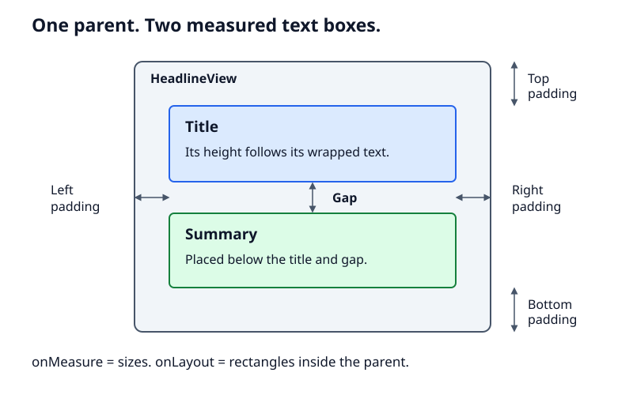
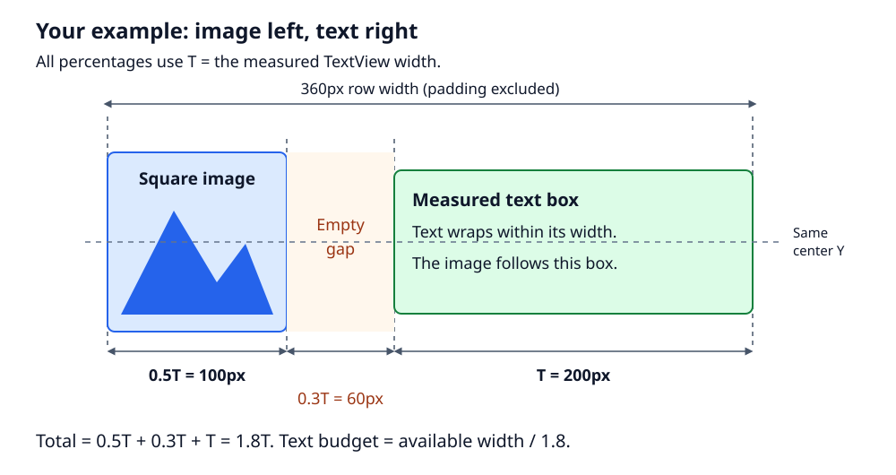
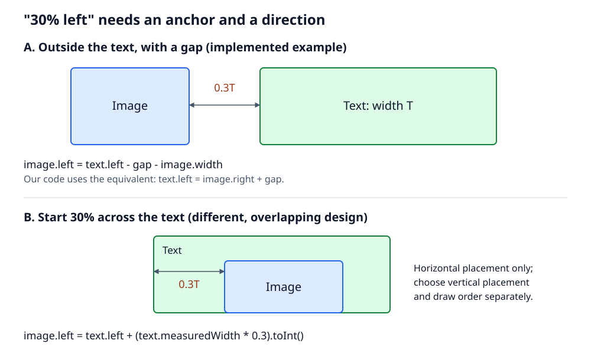

# XML for content. Kotlin for geometry.

**Build an Android layout without writing constraints: declare the children in
XML, then measure and position them in a custom `ViewGroup`.**

Inspired by the screen layouts in [Yumi](https://github.com/Bayram-MKININI/Yumi).
This repository contains an original teaching example, not copied application
code or a UI library.

You should already know basic Kotlin and Android XML layouts. You do not need
experience writing custom Views.

## What we are building

A title followed by a summary, with padding around both and a gap between them:



A `LinearLayout` would be the simplest production choice for this arrangement.
We use a small example so you can learn measurement and placement before
applying them to a more specialized design.

The responsibilities stay separate:

| File | What it owns |
| --- | --- |
| [activity_main.xml](app/src/main/res/layout/activity_main.xml) | Which children exist and how they look |
| [HeadlineView.kt](app/src/main/java/dev/bayram/viewgrouptutorial/HeadlineView.kt) | How much space children get and where they go |
| [MainActivity.kt](app/src/main/java/dev/bayram/viewgrouptutorial/MainActivity.kt) | Hosting the screen and handling system-bar insets |

The children are ordinary `TextView`s. We keep native text rendering, font
scaling, and accessibility nodes; we are not drawing text on a `Canvas`.

## Run it first

Use Android Studio, JDK 17, and Android SDK 36.

```sh
git clone https://github.com/Bayram-MKININI/android-custom-viewgroup-tutorial.git
cd android-custom-viewgroup-tutorial
./gradlew :app:assembleDebug
```

Point `ANDROID_HOME` to your Android SDK, or open the project in Android Studio
and let it create `local.properties`.

With an emulator or device running Android 7.0 (API 24) or newer:

```sh
./gradlew :app:installDebug
```

Launch **Custom ViewGroup Tutorial** from the device launcher. Build and test
downloads require network access on the first run.

## 1. Let XML describe the children

In a usual XML layout, `ConstraintLayout` or `LinearLayout` is the parent tag.
Here, that tag is our own class.

This is the complete [activity_main.xml](app/src/main/res/layout/activity_main.xml):

```xml
<?xml version="1.0" encoding="utf-8"?>
<ScrollView xmlns:android="http://schemas.android.com/apk/res/android"
    android:id="@+id/scroll"
    android:layout_width="match_parent"
    android:layout_height="match_parent"
    android:clipToPadding="false">

    <dev.bayram.viewgrouptutorial.HeadlineView
        android:id="@+id/headline"
        android:layout_width="match_parent"
        android:layout_height="wrap_content"
        android:padding="@dimen/content_padding">

        <TextView
            android:id="@+id/title"
            android:layout_width="match_parent"
            android:layout_height="wrap_content"
            android:text="@string/headline"
            android:textColor="?android:attr/textColorPrimary"
            android:textSize="28sp"
            android:textStyle="bold" />

        <TextView
            android:id="@+id/summary"
            android:layout_width="match_parent"
            android:layout_height="wrap_content"
            android:text="@string/summary"
            android:textColor="?android:attr/textColorSecondary"
            android:textSize="18sp" />
    </dev.bayram.viewgrouptutorial.HeadlineView>
</ScrollView>
```

The relevant [resources](app/src/main/res/values/strings.xml) are:

```xml
<string name="headline">XML for content. Kotlin for geometry.</string>
<string name="summary">These are ordinary Android TextViews. Their parent measures them and places this text below the headline, without a ConstraintLayout.</string>
<dimen name="headline_gap">12dp</dimen>
<dimen name="content_padding">24dp</dimen>
```

XML still owns text, colors, sizes, and padding. What is missing is the rule
"put the summary below the title." We will write that rule in Kotlin.

The `ScrollView` handles a separate concern: when text becomes taller than the
screen, the user can scroll. It is not responsible for arranging the two texts.

## 2. Create the parent and find its children

Open [HeadlineView.kt](app/src/main/java/dev/bayram/viewgrouptutorial/HeadlineView.kt).
The class declaration and fields are:

```kotlin
class HeadlineView @JvmOverloads constructor(
    context: Context,
    attrs: AttributeSet? = null,
    defStyleAttr: Int = 0
) : ViewGroup(context, attrs, defStyleAttr) {

    private lateinit var title: TextView
    private lateinit var summary: TextView
    private val gap = resources.getDimensionPixelSize(R.dimen.headline_gap)
```

This is the **start of the class**, not a complete file yet. The methods below
belong inside it. The linked source contains the complete class and imports.

`@JvmOverloads` provides the constructor Android's XML inflater needs.
`getDimensionPixelSize()` converts our `12dp` resource to pixels. Android's
measurement and layout methods work in pixels, not dp.

When the constructor runs, XML inflation has not finished adding the children.
Find them in `onFinishInflate()`:

```kotlin
    override fun onFinishInflate() {
        super.onFinishInflate()
        require(childCount == 2) { "HeadlineView requires exactly two children" }
        title = requireNotNull(findViewById<TextView>(R.id.title))
        summary = requireNotNull(findViewById<TextView>(R.id.summary))
        require(title.parent === this && summary.parent === this) {
            "Title and summary must be direct children"
        }
    }
```

This makes the component's contract explicit: two direct `TextView` children
with those IDs. Put the title first in XML because our algorithm uses child
order.

**Scope of this sample:** children use `wrap_content` height; the parent fills
the available width as shown in XML. It supports padding and a shared gap, not
margins, weights, arbitrary nested structures, or adding children after
construction. It is not a general replacement for `LinearLayout`.

## 3. Understand the two layout questions

Android separates **size** from **position**:

```text
onMeasure()
    Ask each child how large it needs to be under the supplied limits.
    Report how large this parent will be.

onLayout()
    Give each child its final rectangle inside this parent.
```

Measuring a child does not position it. Positioning it does not measure its text.

The parent passes a `MeasureSpec` for each axis. A spec contains a size and a
mode:

| Example | Meaning |
| --- | --- |
| `EXACTLY 360px` | Your width must be 360px |
| `AT_MOST 360px` | You may choose a width up to 360px |
| `UNSPECIFIED` | This axis has no imposed limit |

These numbers are **pixels**. They are intentionally simple values for the
worked examples, not recommended hardcoded dimensions.

You can inspect a spec like this:

```kotlin
val mode = MeasureSpec.getMode(widthMeasureSpec)
val size = MeasureSpec.getSize(widthMeasureSpec)
```

Reading only `size` loses the rule. For example, an unspecified height with a
size of zero does **not** mean "you must be zero pixels tall."

## 4. Measure the children, then the parent

First, consider an exact width of 360px and 24px padding on each side:

```text
available child width = 360 - 24 - 24 = 312px
```

With the sample's `match_parent` child widths, both texts get exactly 312px.
The `TextView`s calculate their heights using that width, their text, and their
font settings. We do not guess the number of lines.

Use `getChildMeasureSpec()` instead of manually rebuilding all the sizing rules:

```kotlin
            val childWidthSpec = getChildMeasureSpec(
                widthMeasureSpec,
                paddingLeft + paddingRight,
                child.layoutParams.width
            )
```

It combines the incoming spec, space already used by padding, and the child's
requested XML width. For height, also include the space used by earlier
children.

Here is the **complete `onMeasure()` from the sample**:

```kotlin
    override fun onMeasure(widthMeasureSpec: Int, heightMeasureSpec: Int) {
        var contentHeight = 0
        var contentWidth = 0
        var childState = 0
        var visibleCount = 0

        for (index in 0 until childCount) {
            val child = getChildAt(index)
            if (child.visibility == View.GONE) continue
            if (visibleCount > 0) contentHeight += gap

            val childWidthSpec = getChildMeasureSpec(
                widthMeasureSpec,
                paddingLeft + paddingRight,
                child.layoutParams.width
            )
            val childHeightSpec = getChildMeasureSpec(
                heightMeasureSpec,
                paddingTop + paddingBottom + contentHeight,
                child.layoutParams.height
            )
            child.measure(childWidthSpec, childHeightSpec)
            contentWidth = maxOf(contentWidth, child.measuredWidth)
            contentHeight += child.measuredHeight
            childState = combineMeasuredStates(childState, child.measuredState)
            visibleCount++
        }

        setMeasuredDimension(
            resolveSizeAndState(
                maxOf(suggestedMinimumWidth, contentWidth + paddingLeft + paddingRight),
                widthMeasureSpec,
                childState
            ),
            resolveSizeAndState(
                maxOf(suggestedMinimumHeight, contentHeight + paddingTop + paddingBottom),
                heightMeasureSpec,
                childState shl MEASURED_HEIGHT_STATE_SHIFT
            )
        )
    }
```

Read it in three parts:

1. **Skip absent children.** `GONE` children take no space. Add the gap only
   before a second visible child. `INVISIBLE` children still take space.
2. **Measure and accumulate.** Keep the widest child and add up the heights.
   `contentHeight` excludes outer padding, which is added separately.
3. **Resolve the final size.** Ask for content plus padding, respect minimum
   dimensions, then reconcile that request with the incoming specs.

For example, suppose the measured heights are:

```text
top padding        24px
title              68px
gap                12px
summary            90px
bottom padding     24px
-----------------------
desired height    218px
```

`resolveSizeAndState()` then applies the parent's contract:

| Incoming height spec | Reported height for a desired 218px |
| --- | --- |
| `UNSPECIFIED` | 218px |
| `AT_MOST 300px` | 218px |
| `EXACTLY 300px` | 300px |

With a small bounded height, our child specs also constrain text measurement,
so the children may report smaller heights. Respecting a limit does not
guarantee every line remains readable. That is why the runnable screen scrolls.

**What are the state bits?** A child can report that its measured size is too
small. `combineMeasuredStates()` collects these signals. Height state bits need
the `MEASURED_HEIGHT_STATE_SHIFT` shift when passed to the height resolver.
This is reporting information, not an extra layout pass.

**Important:** `setMeasuredDimension()` accepts measured dimensions and state
bits, not `MeasureSpec` values. Do not pass it a result of
`MeasureSpec.makeMeasureSpec()`.

## 5. Position the measured children

Now each child has a `measuredWidth` and `measuredHeight`. Placement is ordinary
rectangle arithmetic:

```text
title.top   = paddingTop
title.bottom = title.top + title.measuredHeight
summary.top = title.bottom + gap
```

A child's coordinates are local to its parent. The screen's status bar height
does not belong in this calculation.

Here is the **complete `onLayout()`**:

```kotlin
    override fun onLayout(changed: Boolean, left: Int, top: Int, right: Int, bottom: Int) {
        var childTop = paddingTop
        var visibleCount = 0

        for (index in 0 until childCount) {
            val child = getChildAt(index)
            if (child.visibility == View.GONE) continue
            if (visibleCount > 0) childTop += gap

            val childLeft = if (layoutDirection == View.LAYOUT_DIRECTION_RTL) {
                right - left - paddingRight - child.measuredWidth
            } else {
                paddingLeft
            }
            child.layout(
                childLeft,
                childTop,
                childLeft + child.measuredWidth,
                childTop + child.measuredHeight
            )
            childTop += child.measuredHeight
            visibleCount++
        }
    }
```

For the example above, left-to-right placement produces:

```text
title:   left=24, top=24,  right=336, bottom=92
summary: left=24, top=104, right=336, bottom=194
```

The last 24px remain bottom padding.

For right-to-left layouts, the start edge is on the right. Subtracting the
child width from the right content edge also works when a child is narrower
than the available space.

Use `right - left` for the width Android actually assigned this parent, not
the display width. A component may be inside a smaller window or another
container.

The class also supplies default child layout parameters:

```kotlin
    override fun generateDefaultLayoutParams(): LayoutParams =
        LayoutParams(LayoutParams.MATCH_PARENT, LayoutParams.WRAP_CONTENT)
```

That completes the layout methods. See the [full source](app/src/main/java/dev/bayram/viewgrouptutorial/HeadlineView.kt)
for the assembled class.

## 6. Expose a small content API

The controller should supply text without needing to know how it is placed.
Add this method inside `HeadlineView`:

```kotlin
    /** Changes text through TextView so size changes trigger layout automatically. */
    fun setContent(title: CharSequence, summary: CharSequence) {
        this.title.text = title
        this.summary.text = summary
    }
```

Call it from an activity **after** `setContentView()`:

```kotlin
setContentView(R.layout.activity_main)

val headline = findViewById<HeadlineView>(R.id.headline)
headline.setContent(
    getString(R.string.headline),
    getString(R.string.summary)
)
```

The runnable activity also applies window insets; keep that handling when
adapting the snippet.

`TextView` requests layout when a text change requires it. If you later add a
property that changes your own geometry, such as a configurable gap, its
setter must call `requestLayout()`. For a drawing-only property, use
`invalidate()`.

Keep data fetching and navigation outside this layout. Knowing how to place
text does not require knowing where that text came from.

## 7. Check the behavior

You can construct a parent constraint in a test with `makeMeasureSpec()`.
Here is an excerpt from the [included tests](app/src/test/java/dev/bayram/viewgrouptutorial/HeadlineViewTest.kt):

```kotlin
    @Test
    fun `given exact bounds - on measuring - it should keep the requested size`() {
        // SETUP
        val view = inflate()

        // RUN
        view.measure(spec(600, MeasureSpec.EXACTLY), spec(400, MeasureSpec.EXACTLY))

        // ASSERT
        assertEquals(600, view.measuredWidth)
        assertEquals(400, view.measuredHeight)
    }
```

`inflate()` loads the sample XML and returns its `HeadlineView`. `spec()` is
just this private test helper:

```kotlin
    private fun spec(size: Int, mode: Int): Int = MeasureSpec.makeMeasureSpec(size, mode)
```

The tests run with Robolectric and JUnit; the linked file includes the runner,
imports, and helpers. Run them without an emulator:

```sh
./gradlew :app:testDebugUnitTest :app:lintDebug
```

Coverage includes exact dimensions, size limits, unbounded height, a hidden
summary, RTL placement, and updating the displayed text.

Also check the app on a device with large fonts, long text, narrow windows,
and TalkBack. Unit tests do not prove that a layout is readable or accessible.

## 8. Size an image from text, then position it

Now use a relationship that is more interesting than a vertical stack:

> Make the image square. Each side is 50% of the measured text width.
> Place it physically to the left of the text, separated by a gap equal to
> 30% of that same text width. Center both vertically.

These percentages refer to the **measured `TextView` box**, not the width of
individual letters, the image's original dimensions, or the parent width.



This is real layout, not a visual translation: the parent reserves space for
the image and gap. A `translationX` would move the drawing without updating
the space occupied by the row.

### Calculate the text budget before measuring

If we measured the text using the entire available row width, then added an
image and gap, the row could overflow.

Instead, write the equation:

```text
image width + gap + text width <= available width
0.5T        + 0.3T + T         <= available width
1.8T                          <= available width
T                             <= available width / 1.8
```

For an available width of 360px:

```text
text width limit = 360 / 1.8 = 200px

If text measures 200px: image=100px, gap=60px, row=360px.
If text measures 100px: image=50px,  gap=30px, row=180px.
```

The second case matters: short text is allowed to measure smaller than its
budget. The image follows the **actual text width**, not the maximum budget.
Unused width stays at the right of this left-aligned row.

### Declare the image and text

The second example has its own [XML layout](app/src/main/res/layout/image_text_example.xml).
Here is the custom parent inside that file's `ScrollView`:

```xml
    <dev.bayram.viewgrouptutorial.ImageTextView
        android:id="@+id/image_text"
        android:layout_width="match_parent"
        android:layout_height="wrap_content"
        android:padding="@dimen/content_padding">

        <ImageView
            android:id="@+id/example_image"
            android:layout_width="wrap_content"
            android:layout_height="wrap_content"
            android:importantForAccessibility="no"
            android:scaleType="centerInside"
            android:src="@drawable/example_landscape" />

        <TextView
            android:id="@+id/example_text"
            android:layout_width="wrap_content"
            android:layout_height="wrap_content"
            android:text="@string/summary"
            android:textColor="?android:attr/textColorPrimary"
            android:textSize="18sp" />
    </dev.bayram.viewgrouptutorial.ImageTextView>
```

`example_landscape` is an included vector drawing. This image is decorative,
so it is excluded from accessibility. A meaningful image should instead have
a localized `contentDescription`.

`scaleType` controls how the drawable appears **inside** the image box.
`centerInside` fits it without cropping or upscaling. `centerCrop` would fill
the box and crop excess content. Neither changes the box size computed below.

### Measure the text first, then the image

The [complete ImageTextView](app/src/main/java/dev/bayram/viewgrouptutorial/ImageTextView.kt)
binds `image` and `text` in `onFinishInflate()`, just like our first example.
Its core measurement code is:

```kotlin
        val availableWidth = (
            MeasureSpec.getSize(widthMeasureSpec) - paddingLeft - paddingRight
        ).coerceAtLeast(0)

        val textWidthLimit = (availableWidth / 1.8).toInt()
        text.measure(
            MeasureSpec.makeMeasureSpec(textWidthLimit, MeasureSpec.AT_MOST),
            MeasureSpec.makeMeasureSpec(0, MeasureSpec.UNSPECIFIED)
        )

        val imageSide = (text.measuredWidth * 0.5).toInt()
        gap = (text.measuredWidth * 0.3).toInt()
        image.measure(
            MeasureSpec.makeMeasureSpec(imageSide, MeasureSpec.EXACTLY),
            MeasureSpec.makeMeasureSpec(imageSide, MeasureSpec.EXACTLY)
        )
```

There are three deliberate choices:

1. `AT_MOST` lets short text occupy less than its budget.
2. `UNSPECIFIED` height lets text grow as it wraps.
3. `EXACTLY` makes the image box the square we calculated.

`toInt()` rounds positive dimensions down to whole pixels. Ratios can therefore
differ by less than one pixel from their mathematical values.

The parent then reports:

```text
desired width  = left padding + image side + gap + text width + right padding
desired height = top padding + max(image side, text height) + bottom padding
```

The full source applies `resolveSizeAndState()` and propagates child state,
as in the first example.

**This example's contract is bounded width and unbounded height.** Its
`ScrollView` provides that combination. The implementation rejects unbounded
width or bounded height instead of pretending it can preserve every rule in
those situations. Both children must stay visible; margins are unsupported.

If the product needs this row in a fixed-height area, decide what should give:
scroll, crop text, reduce the image, or change the layout. Those are different
behaviors, not interchangeable implementation details.

### Place the two boxes

Here is the complete placement method:

```kotlin
    override fun onLayout(changed: Boolean, left: Int, top: Int, right: Int, bottom: Int) {
        val rowHeight = maxOf(image.measuredHeight, text.measuredHeight)
        val imageLeft = paddingLeft
        val imageTop = paddingTop + (rowHeight - image.measuredHeight) / 2
        image.layout(
            imageLeft,
            imageTop,
            imageLeft + image.measuredWidth,
            imageTop + image.measuredHeight
        )

        val textLeft = image.right + gap
        val textTop = paddingTop + (rowHeight - text.measuredHeight) / 2
        text.layout(
            textLeft,
            textTop,
            textLeft + text.measuredWidth,
            textTop + text.measuredHeight
        )
    }
```

The taller box defines the row height. Subtracting each child's height and
dividing by two vertically centers the shorter child, within pixel rounding.

This example intentionally uses **physical left**, including in RTL. If your
design means "before the text in reading order," use a start/end rule and mirror
the horizontal placement for RTL instead.

To display this second example, change the existing `setContentView()` call in
`MainActivity` to:

```kotlin
setContentView(R.layout.image_text_example)
```

Keep the activity's existing inset listener. Both XML files expose the same
`scroll` ID, so that code works for either example.

The [image-layout tests](app/src/test/java/dev/bayram/viewgrouptutorial/ImageTextViewTest.kt)
check the actual size ratios, gap, bounds, and vertical alignment across
different text lengths and widths, plus physical-left placement in RTL.

## 9. What relationships can you express?

Any relationship you can calculate can be a candidate layout rule. These are
**formulas to adapt**, not extra features implemented by the sample:

| Desired rule | Example calculation | What must be known first |
| --- | --- | --- |
| Image width is 50% of text width | `imageWidth = (text.measuredWidth * 0.5).toInt()` | Measured text width |
| Square image follows text height | `imageSide = text.measuredHeight` | Text measured at a chosen width |
| Preserve an image's aspect ratio | `imageHeight = (imageWidth / aspectRatio).toInt()` | Chosen width and positive aspect ratio |
| Width is a fraction of parent content | `imageWidth = (contentWidth * 0.25).toInt()` | Bounded parent content width |
| Image fills space left by text | `imageWidth = (contentWidth - text.measuredWidth - gap).coerceAtLeast(0)` | Measured text and gap |
| A background covers two children | `backgroundWidth = maxOf(first.measuredWidth, second.measuredWidth)` | Both children measured |
| Clamp an image to a design range | `imageSide = preferredSide.coerceIn(minSide, maxSide)` | Valid min/max bounds that fit the parent |
| Place image after text | `imageLeft = text.right + gap` | Text laid out |
| Place image 30% across the text | `imageLeft = text.left + (text.measuredWidth * 0.3).toInt()` | Text laid out |
| Place image to text's left with a 30% gap | `imageLeft = text.left - gap - image.measuredWidth` | Text position, image size, and calculated gap |
| Overlap the image halfway across a text edge | `imageLeft = text.right - image.measuredWidth / 2` | Both sizes and text position |
| Match a text baseline | `secondTop = first.top + first.baseline - second.baseline` | TextViews with valid baselines |
| Change arrangement at a width threshold | Choose side-by-side or stacked geometry | Available content width |

"At 30% left" is ambiguous: starting 30% **across** a text box and sitting
**outside its left edge with a 30% gap** are different layouts. Write the
equation before writing the code.



### Resolve dependencies; do not measure in a circle

Our image example has a clear order:

```text
available width
    -> text width budget
        -> measured text
            -> image size and gap
                -> parent size
                    -> child positions
```

Some designs create a cycle:

```text
text width depends on image width
image width depends on text height
text height depends on text width
```

There is no guaranteed correct result from repeatedly measuring until things
"look stable." Solve the relationship first, choose an independent size, or
define an explicit fallback. Even simple equations can conflict: `image = 0.5
* text` and `text = 0.5 * image` only admit zero sizes.

When placement overlaps children or extends beyond them, include the intended
visual bounds in the parent's desired size. Also consider draw order, clipping,
and touch targets. Moving a child does not automatically enlarge its parent.

**This control is not unique to custom ViewGroups.** ConstraintLayout supports
many relationships through ratios, guidelines, barriers, chains, and
constraints. Standard containers and Compose custom layouts offer other ways
to express them. The benefit here is that a specialized rule can be written
directly as Kotlin arithmetic, with its measurement order explicit.

## An alternative: let the widget inflate its own children

Our sample uses **external inflation**: the screen XML lists the children, and
`onFinishInflate()` finds them.

Yumi also contains self-contained widgets that inflate an internal `<merge>`
layout. The difference is who owns the children:

```xml
<!-- External inflation: the caller supplies the child declarations. -->
<example.HeadlineView ...>
    <TextView ... />
    <TextView ... />
</example.HeadlineView>
```

```xml
<!-- Internal inflation: the caller only declares the widget. -->
<example.SelfContainedHeadlineView ... />
```

These are structural sketches, not paste-ready XML. For the second pattern,
the widget constructor would inflate an internal resource like this:

```kotlin
LayoutInflater.from(context).inflate(R.layout.headline_children, this, true)
```

That internal resource would use `<merge>` as its root and contain the two
`TextView`s. Bind references after that internal `inflate()` returns. The merge
root avoids adding another container.

**Choose one pattern.** Do not add the same children internally and through the
screen XML. This repository implements only the external-inflation version.

## Is it faster than ConstraintLayout?

A purpose-built `ViewGroup` can avoid constraint solving and replace some
nested containers with direct arithmetic. That can be useful for a predictable
arrangement.

But fewer XML lines do not prove faster frames. Text measurement, repeated
layout passes, drawing, and update frequency all matter. ConstraintLayout can
also flatten a hierarchy that would otherwise be deeply nested.

This sample calls `measure()` once per visible child per `onMeasure()` call.
Android can still invoke the parent's `onMeasure()` more than once, and children
can perform additional work internally.

There is **no comparative benchmark in this repository**, so it makes no
numerical speedup claim. To compare fairly:

1. Build the same appearance and behavior with ConstraintLayout.
2. Use identical content, fonts, devices, and release-like build settings.
3. Measure initial display and repeated updates or scrolling separately.
4. Use Macrobenchmark frame timings and Perfetto traces to inspect layout work.
5. Repeat runs and publish distributions, device details, and build settings.

Choose the custom parent when an explicit layout algorithm is easier to
understand and maintain. Choose a standard container when it already expresses
the design clearly.

## Common mistakes

| Mistake | Better approach |
| --- | --- |
| Finding externally inflated children in the constructor | Bind them in `onFinishInflate()` |
| Treating every incoming size as exact | Respect the `MeasureSpec` mode |
| Measuring text with unlimited width | Supply the available width so text can wrap |
| Positioning children without measuring them | Measure first, then use their measured dimensions |
| Adding a gap for a `GONE` child | Skip it in both measurement and placement |
| Using screen width inside a reusable component | Use the width assigned to that parent |
| Hardcoding a status bar height | Apply real insets at the screen boundary |
| Expecting margin attributes to work automatically | Implement margin handling or document that it is unsupported |
| Claiming performance from a shallow hierarchy alone | Measure equivalent implementations |

The sample activity handles insets on all four edges. The component has no
additional mutable UI state to restore; a richer widget that introduces such
state should implement state restoration.

## Why a tutorial, not a library?

The useful idea is small: **XML owns content and styling. Kotlin owns geometry.
The controller supplies data.**

Start with one layout you can understand completely. Extract a library when
multiple real consumers need the same stable behavior, not just because several
screens override `onMeasure()` and `onLayout()`.

## References

- [Custom ViewGroup](https://developer.android.com/develop/ui/views/layout/custom-views/custom-components#custom)
- [View.MeasureSpec](https://developer.android.com/reference/android/view/View.MeasureSpec)
- [ViewGroup.getChildMeasureSpec](https://developer.android.com/reference/android/view/ViewGroup#getChildMeasureSpec(int,int,int))
- [View.resolveSizeAndState](https://developer.android.com/reference/android/view/View#resolveSizeAndState(int,int,int))
- [Macrobenchmark](https://developer.android.com/topic/performance/benchmarking/macrobenchmark-overview)
