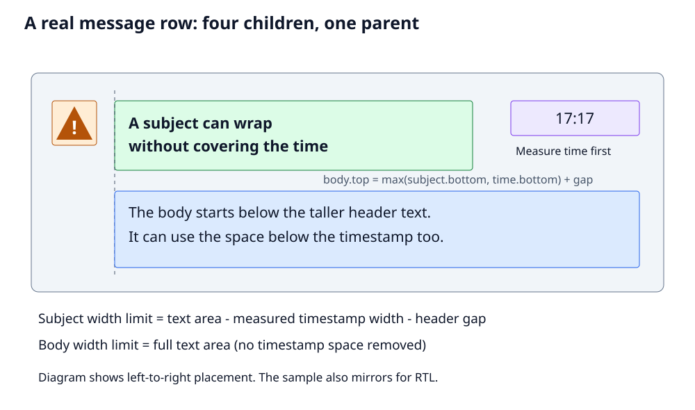
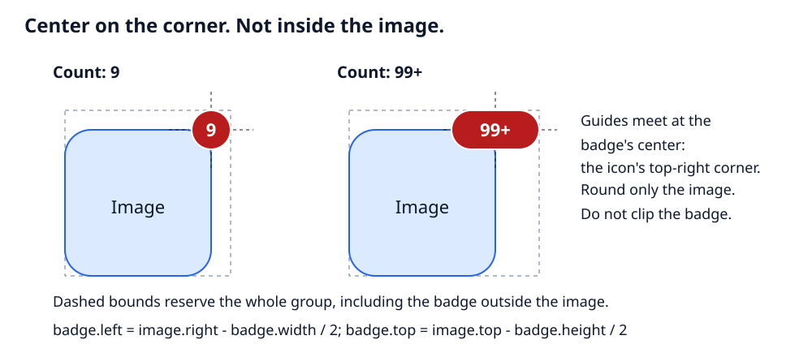
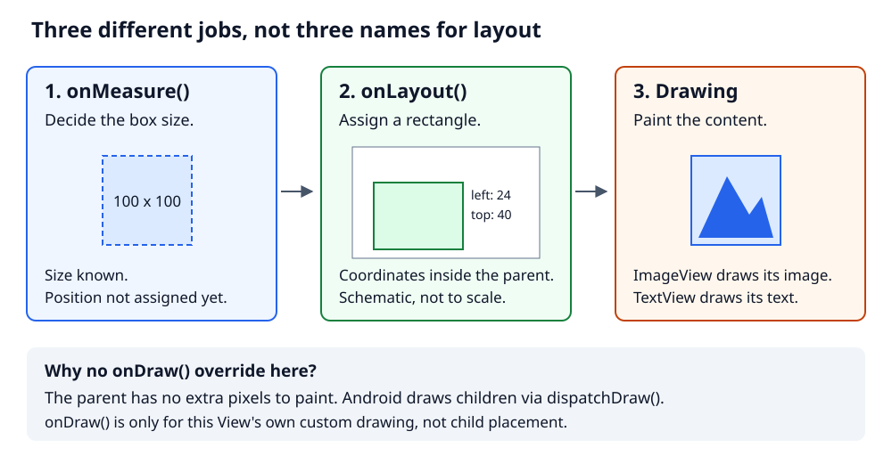
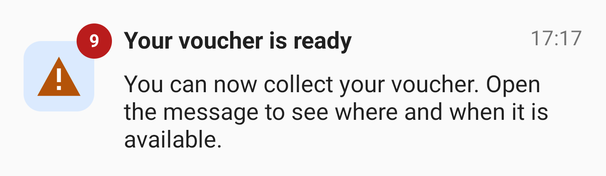

# Build a message row, then add a corner badge

A message has a priority icon, a subject, a time, and a body.
The subject must leave room for the time.
The body can use more width.
Its position depends on the height of both header texts.

These message-row rules come from [Yumi](https://github.com/Bayram-MKININI/Yumi).
Then we add a new request: a count badge centered on the icon's corner.
We will build both in one custom ViewGroup.
You need basic Kotlin and Android XML knowledge.

## Start here

Clone the project.
All examples use its package and resources.

Use Android Studio, JDK 17, and Android SDK 36:

```sh
git clone https://github.com/Bayram-MKININI/android-custom-viewgroup-tutorial.git
cd android-custom-viewgroup-tutorial
```

Open the project in Android Studio to set the SDK location.
Or set `ANDROID_HOME` to your SDK.

The message row is the default screen:

```sh
./gradlew :app:assembleDebug
./gradlew :app:installDebug
```

The install command needs a device or emulator running API 24 or newer.
Open **Custom ViewGroup Tutorial**.
The first build needs internet access.

## 1. Look at the real app

Read Yumi's original files:

- [MessageItemView.kt](https://github.com/Bayram-MKININI/Yumi/blob/5b4032fbfc7bdf707d5f597b137aeff3db819515/app/src/main/java/net/noliaware/yumi/feature_message/presentation/views/MessageItemView.kt)
- [message_item_layout.xml](https://github.com/Bayram-MKININI/Yumi/blob/5b4032fbfc7bdf707d5f597b137aeff3db819515/app/src/main/res/layout/message_item_layout.xml)

The original parent measures and places four children.
It measures the icon and time before the subject.
It gives the body more width than the subject.
Then it puts the body below the taller header text.
The body preview has a five-line limit.

Our sample keeps those message rules and adds the badge.
It uses new teaching code, simpler styling, and different spacing.
It also adds RTL support and explicit size limits.
It does not copy the app's implementation or reproduce its exact appearance.

First, look at the row without the new badge:



## 2. Start with a simple arrangement

You could put the icon beside a text column.
Inside that column, put a header row above the body:

```text
Horizontal layout
    -> Icon
    -> Vertical layout
        -> Horizontal header
            -> Subject
            -> Time
        -> Body
```

This is a valid solution.
Nested layouts are not wrong.

But the sizes are not all independent.
The time must keep its space.
The subject must wrap before it reaches the time.
The body must start below both texts, not only below the subject.

Try a longer timestamp, such as "Yesterday 17:17".
It needs more width.
That leaves less width for the subject.
But it must not reduce the body's width.

So far, standard layouts can handle the design.
Now imagine one more request.

### "Can we add a badge on the icon?"

Put a small count badge on the image's upper-right corner.
The image may have rounded corners too.

Your horizontal layout puts children beside each other.
It does not overlap them.
You could put the icon and badge inside a `FrameLayout`:

```text
Horizontal layout
    -> FrameLayout
        -> Icon
        -> Badge
    -> Vertical layout
        -> Horizontal header
            -> Subject
            -> Time
        -> Body
```

That can place a badge **inside** the image's corner.
But the new request is more precise:

> Put the badge's center exactly on the image's upper-right corner.
> Let the badge extend outside the image.
> Keep the image rounded, but do not clip the badge.

Think of the red count badge on an app icon, such as Gmail.
For `9`, use a circle.
Its center is `(image.right, image.top)`.
Half the circle is above the image's top edge.
Half is to the right of its right edge.
The badge is not placed fully inside the image.

Here, "corner" means the upper-right corner of the image's rectangular bounds.
It does not mean a point along the rounded outline.

You try a fixed offset.
It works with `9`.
Then the count becomes `99+`.
The badge gets wider.
The offset must now depend on the badge's measured width.

You also round the image.
If the badge is inside the same rounded, clipped container, it can be cut off.
Now placement and clipping are two separate problems.



Now ask:

- How wide is the badge after measuring its text?
- How much space does it need outside the icon?
- Will it overlap the subject or be clipped by a parent?
- Should the text start after the icon, or after the whole icon-and-badge group?

Adding a wrapper did not answer those questions.
You need a clear rule for the size of the group.

This is a **new design extension to the real message row**.
This exact center-on-corner rule is not taken from Yumi's source.
The runnable sample below includes all five children, including the badge.

### Do we need a custom ViewGroup?

Not strictly.
**ConstraintLayout can also express these relationships.**
It can constrain the subject before the time and use a bottom barrier for the body.
It can also help position an overlapping badge.

So why choose a custom parent?
We want one place to read the whole rule:
**measure the icon and badge, reserve their full space, then measure the texts.**
The XML holds the content and style.
The Kotlin parent holds the size and position rules.

The tradeoff is real.
We must handle measurement, RTL, and unsupported sizes ourselves.
ConstraintLayout already handles much of that work.
Use it if its constraints are easier for your team to maintain.
Here, we choose direct code to learn how those layout decisions work.

## 3. Give each method one job

A `ViewGroup` is a View that contains other Views.
It is the **parent**.
The Views inside it are its **children**.

Our parent has five direct children:

```text
MessageRowView
    -> Priority ImageView
    -> Subject TextView
    -> Time TextView
    -> Body TextView
    -> Badge TextView
```

The badge is last so Android draws it above the icon.
The icon and badge are siblings, not a rounded parent and its child.

Android separates three jobs:

| Method | Job |
| --- | --- |
| `onMeasure()` | Measure children and report the parent's size |
| `onLayout()` | Assign each child a rectangle |
| `onDraw()` | Paint this View's own custom content |

We only need the first two.
The children already know how to draw text and images.
Android draws them through `dispatchDraw()`.
Our parent has no extra content to paint in `onDraw()`.



## 4. Measure the icon and badge before the texts

First, find the width inside the row's padding:

```kotlin
val contentWidth = MeasureSpec.getSize(widthMeasureSpec) - paddingLeft - paddingRight
```

All measurement code uses pixels.
The resource values, such as `16dp`, are converted by Android.
The width comes from the parent, not the full screen.

Android describes each size with a `MeasureSpec`:

| Mode | Meaning |
| --- | --- |
| `EXACTLY` | Use this size |
| `AT_MOST` | Use up to this size |
| `UNSPECIFIED` | No limit for this width or height |

The icon gets an exact size.
The badge gets enough room to measure its text:

```kotlin
val unlimitedHeight = MeasureSpec.makeMeasureSpec(0, MeasureSpec.UNSPECIFIED)
val iconSpec = MeasureSpec.makeMeasureSpec(iconSize, MeasureSpec.EXACTLY)
icon.measure(iconSpec, iconSpec)
badge.measure(
    MeasureSpec.makeMeasureSpec(contentWidth, MeasureSpec.AT_MOST),
    unlimitedHeight
)
```

### Reserve the full icon-and-badge rectangle

For a moment, put the icon at `(0, 0)`.
Its upper-right corner is `(icon.measuredWidth, 0)`.
Center the badge there:

```kotlin
val badgeLeft = icon.measuredWidth - badge.measuredWidth / 2
val badgeTop = -badge.measuredHeight / 2
```

The negative top is expected.
The badge extends above the icon.
But the row must contain both children.
Find the smallest rectangle around them:

```kotlin
iconGroup.set(0, 0, icon.measuredWidth, icon.measuredHeight)
iconGroup.union(
    badgeLeft, badgeTop,
    badgeLeft + badge.measuredWidth, badgeTop + badge.measuredHeight
)
```

`iconGroup` is an Android `Rect`.
It stores four edges. It is **not another View or wrapper**.
`union()` expands it to include the badge.

Here is a complete example in pixels:

```text
Icon: 48 x 48. Badge: 24 x 24.

Before the shift:    left   top   right   bottom
Icon                   0     0      48       48
Badge                 36   -12      60       12
Group                  0   -12      60       48

Group size: 60 x 60.
Row padding: 16 on each side.
Move both children by (+16, +28).

After the shift:     left   top   right   bottom
Icon                  16    28      64       76
Badge                 52    16      76       40
Group                 16    16      76       76

Badge center: (64, 28).
Icon top-right corner: (64, 28). They match.
```

Why `+28` vertically?
The group's old top is `-12`.
To move it to the padding at `16`, add `16 - (-12) = 28`.
No child now extends outside the row.

### Measure the time before the subject

Remove the whole group's width, not just the icon's width:

```kotlin
val textAreaWidth = contentWidth - iconGroup.width() - iconGap
time.measure(
    MeasureSpec.makeMeasureSpec(textAreaWidth, MeasureSpec.AT_MOST),
    unlimitedHeight
)
```

Now we know `time.measuredWidth`.
Remove it, plus the header gap, from the subject's width limit:

```kotlin
val subjectWidth = textAreaWidth - time.measuredWidth - headerGap
subject.measure(
    MeasureSpec.makeMeasureSpec(subjectWidth, MeasureSpec.AT_MOST),
    unlimitedHeight
)
```

For example:

```text
text area width      300px
timestamp width       50px
header gap            12px
--------------------------
subject width limit  238px
```

A wider time means a smaller subject limit.
The sample reports an error if the timestamp leaves no subject space.
A production design should define a fallback for that case.

## 5. Give the body its own width

The timestamp only reserves space on the header row.
Do not remove its width when measuring the body:

```kotlin
body.measure(
    MeasureSpec.makeMeasureSpec(textAreaWidth, MeasureSpec.AT_MOST),
    unlimitedHeight
)
```

Now calculate the height:

```kotlin
val headerHeight = maxOf(subject.measuredHeight, time.measuredHeight)
val contentHeight = maxOf(
    iconGroup.height(),
    headerHeight + bodyGap + body.measuredHeight
)
```

Why use `maxOf()`?
The subject may wrap onto several lines.
The time could also be taller, for example with a different text size.
The body must start below whichever is taller.
The row must also contain the whole icon-and-badge group.

Add top and bottom padding to get the parent's desired height.
Use `resolveSizeAndState()` and `setMeasuredDimension()` to report it.
Do not pass `MeasureSpec` values to `setMeasuredDimension()`.

## 6. Place the children in onLayout

Measurement gives sizes, not positions.
For left-to-right reading, place the children like this:

```text
Group:   at the start and top padding
Icon:    shifted inside the group
Badge:   centered on the icon's top-right corner
Subject: after the group and icon gap
Time:    against the end padding
Body:    aligned with the subject, below both header texts
```

The group rectangle tells us how far to shift the icon:

```kotlin
val iconLeft = groupLeft - iconGroup.left
val iconTop = paddingTop - iconGroup.top
val badgeLeft = iconLeft + icon.measuredWidth - badge.measuredWidth / 2
val badgeTop = iconTop - badge.measuredHeight / 2
```

In LTR, `groupLeft` is `paddingLeft`.
In RTL, the group moves to the right of the row.
The badge still uses the icon's **physical top-right corner**.
This is a design choice, not a reading-direction rule.
Integer division may move the center by half a pixel for odd badge sizes.

The key body rule is:

```kotlin
val bodyTop = maxOf(subject.bottom, time.bottom) + bodyGap
```

Do not use `subject.bottom` alone.
That could overlap a taller timestamp.

Each child receives `layout(left, top, right, bottom)`:

```kotlin
body.layout(
    bodyLeft,
    bodyTop,
    bodyLeft + body.measuredWidth,
    bodyTop + body.measuredHeight
)
```

These arguments are edges, not x, y, width, height.
Coordinates are inside this parent, not the screen.
The full class mirrors placement for right-to-left layouts.

## 7. The complete example

The row sits inside a `ScrollView`.
It requires an exact width and no height limit.
All five children must stay visible.
Child margins are not supported.
The parent owns the spacing.

### XML

Save this as `app/src/main/res/layout/message_row_example.xml`:

```xml
<?xml version="1.0" encoding="utf-8"?>
<ScrollView xmlns:android="http://schemas.android.com/apk/res/android"
    android:id="@+id/scroll"
    android:layout_width="match_parent"
    android:layout_height="match_parent">

    <dev.bayram.viewgrouptutorial.MessageRowView
        android:id="@+id/message_row"
        android:layout_width="match_parent"
        android:layout_height="wrap_content"
        android:padding="@dimen/message_padding">

        <ImageView
            android:id="@+id/message_icon"
            android:layout_width="wrap_content"
            android:layout_height="wrap_content"
            android:background="@drawable/message_icon_background"
            android:clipToOutline="true"
            android:contentDescription="@string/message_priority"
            android:padding="8dp"
            android:src="@drawable/message_priority" />

        <TextView
            android:id="@+id/message_subject"
            android:layout_width="wrap_content"
            android:layout_height="wrap_content"
            android:text="@string/message_subject"
            android:textColor="?android:attr/textColorPrimary"
            android:textSize="16sp"
            android:textStyle="bold" />

        <TextView
            android:id="@+id/message_time"
            android:layout_width="wrap_content"
            android:layout_height="wrap_content"
            android:text="@string/message_time"
            android:textColor="?android:attr/textColorSecondary"
            android:textSize="14sp" />

        <TextView
            android:id="@+id/message_body"
            android:layout_width="wrap_content"
            android:layout_height="wrap_content"
            android:maxLines="5"
            android:text="@string/message_body"
            android:textColor="?android:attr/textColorPrimary"
            android:textSize="16sp" />

        <TextView
            android:id="@+id/message_badge"
            android:layout_width="wrap_content"
            android:layout_height="wrap_content"
            android:background="@drawable/message_badge_background"
            android:gravity="center"
            android:includeFontPadding="false"
            android:minWidth="24dp"
            android:minHeight="24dp"
            android:paddingLeft="6dp"
            android:paddingTop="2dp"
            android:paddingRight="6dp"
            android:paddingBottom="2dp"
            android:singleLine="true"
            android:text="@string/message_badge"
            android:textColor="#FFFFFF"
            android:textSize="12sp"
            android:textStyle="bold" />
    </dev.bayram.viewgrouptutorial.MessageRowView>
</ScrollView>
```

The project includes the [strings and dimensions](app/src/main/res/values/strings.xml)
and [priority icon](app/src/main/res/drawable/message_priority.xml).
The icon is now `48dp` so the badge is easy to see.
The [icon background](app/src/main/res/drawable/message_icon_background.xml)
has rounded corners. `clipToOutline` clips only the icon.
The [badge background](app/src/main/res/drawable/message_badge_background.xml)
has fully rounded ends.
With `9` and the default font size, the badge is a circle.
With `99+`, it becomes a wider pill.
Both shapes keep the same center rule.
The icon has a translated description because it communicates priority.
The body is a five-line preview, as in Yumi.
This sample does not implement opening the full message.

The custom parent supplies child size rules itself.
Here, XML `wrap_content` does not choose the icon size or available text widths.

### Kotlin

The layout idea is now complete.
The full class also finds the XML children, checks its size limits,
and reports child measurement warnings to Android.
Those are supporting details, not new placement rules.

<details>
<summary>Complete MessageRowView.kt — expand to read or copy</summary>

```kotlin
package dev.bayram.viewgrouptutorial

import android.content.Context
import android.graphics.Rect
import android.util.AttributeSet
import android.view.ViewGroup
import android.widget.ImageView
import android.widget.TextView

/**
 * Adds a corner badge to Yumi's message-row rules, reserving its full bounds.
 * Requires exact width, unbounded height, and five visible XML children without margins.
 */
class MessageRowView @JvmOverloads constructor(
    context: Context,
    attrs: AttributeSet? = null,
    defStyleAttr: Int = 0
) : ViewGroup(context, attrs, defStyleAttr) {

    private lateinit var icon: ImageView
    private lateinit var subject: TextView
    private lateinit var time: TextView
    private lateinit var body: TextView
    private lateinit var badge: TextView
    private val iconGroup = Rect()
    private val iconSize = resources.getDimensionPixelSize(R.dimen.message_icon_size)
    private val iconGap = resources.getDimensionPixelSize(R.dimen.message_icon_gap)
    private val headerGap = resources.getDimensionPixelSize(R.dimen.message_header_gap)
    private val bodyGap = resources.getDimensionPixelSize(R.dimen.message_body_gap)

    override fun onFinishInflate() {
        super.onFinishInflate()
        require(childCount == 5) { "MessageRowView requires exactly five children" }
        icon = requireNotNull(findViewById<ImageView>(R.id.message_icon))
        subject = requireNotNull(findViewById<TextView>(R.id.message_subject))
        time = requireNotNull(findViewById<TextView>(R.id.message_time))
        body = requireNotNull(findViewById<TextView>(R.id.message_body))
        badge = requireNotNull(findViewById<TextView>(R.id.message_badge))
        require(listOf(icon, subject, time, body, badge).all { it.parent === this }) {
            "All five views must be direct children"
        }
    }

    override fun onMeasure(widthMeasureSpec: Int, heightMeasureSpec: Int) {
        require(MeasureSpec.getMode(widthMeasureSpec) == MeasureSpec.EXACTLY) {
            "MessageRowView requires exact width"
        }
        require(MeasureSpec.getMode(heightMeasureSpec) == MeasureSpec.UNSPECIFIED) {
            "MessageRowView requires unbounded height; use the sample ScrollView"
        }
        require(listOf(icon, subject, time, body, badge).all { it.visibility == VISIBLE }) {
            "This example requires all five children to be visible"
        }
        val contentWidth = MeasureSpec.getSize(widthMeasureSpec) - paddingLeft - paddingRight
        require(contentWidth > 0) { "Not enough width for the message row" }

        val unlimitedHeight = MeasureSpec.makeMeasureSpec(0, MeasureSpec.UNSPECIFIED)
        val iconSpec = MeasureSpec.makeMeasureSpec(iconSize, MeasureSpec.EXACTLY)
        icon.measure(iconSpec, iconSpec)
        badge.measure(
            MeasureSpec.makeMeasureSpec(contentWidth, MeasureSpec.AT_MOST),
            unlimitedHeight
        )
        val badgeLeft = icon.measuredWidth - badge.measuredWidth / 2
        val badgeTop = -badge.measuredHeight / 2
        iconGroup.set(0, 0, icon.measuredWidth, icon.measuredHeight)
        iconGroup.union(
            badgeLeft, badgeTop,
            badgeLeft + badge.measuredWidth, badgeTop + badge.measuredHeight
        )
        val textAreaWidth = contentWidth - iconGroup.width() - iconGap
        require(textAreaWidth > headerGap) { "Not enough width for the message row" }

        time.measure(
            MeasureSpec.makeMeasureSpec(textAreaWidth, MeasureSpec.AT_MOST),
            unlimitedHeight
        )

        val subjectWidth = textAreaWidth - time.measuredWidth - headerGap
        require(subjectWidth > 0) { "Timestamp leaves no space for the subject" }
        subject.measure(
            MeasureSpec.makeMeasureSpec(subjectWidth, MeasureSpec.AT_MOST),
            unlimitedHeight
        )
        body.measure(
            MeasureSpec.makeMeasureSpec(textAreaWidth, MeasureSpec.AT_MOST),
            unlimitedHeight
        )

        val headerHeight = maxOf(subject.measuredHeight, time.measuredHeight)
        val contentHeight = maxOf(
            iconGroup.height(),
            headerHeight + bodyGap + body.measuredHeight
        )
        val childState = listOf(icon, subject, time, body, badge).fold(0) { state, child ->
            combineMeasuredStates(state, child.measuredState)
        }
        setMeasuredDimension(
            resolveSizeAndState(MeasureSpec.getSize(widthMeasureSpec), widthMeasureSpec, childState),
            resolveSizeAndState(
                maxOf(suggestedMinimumHeight, paddingTop + contentHeight + paddingBottom),
                heightMeasureSpec,
                childState shl MEASURED_HEIGHT_STATE_SHIFT
            )
        )
    }

    override fun onLayout(changed: Boolean, left: Int, top: Int, right: Int, bottom: Int) {
        val rtl = layoutDirection == LAYOUT_DIRECTION_RTL
        val contentRight = right - left - paddingRight
        val groupLeft = if (rtl) contentRight - iconGroup.width() else paddingLeft
        val textStart = if (rtl) groupLeft - iconGap
            else groupLeft + iconGroup.width() + iconGap
        val iconLeft = groupLeft - iconGroup.left
        val iconTop = paddingTop - iconGroup.top
        val badgeLeft = iconLeft + icon.measuredWidth - badge.measuredWidth / 2
        val badgeTop = iconTop - badge.measuredHeight / 2
        val subjectLeft = if (rtl) textStart - subject.measuredWidth else textStart
        val timeLeft = if (rtl) paddingLeft else contentRight - time.measuredWidth
        val bodyLeft = if (rtl) textStart - body.measuredWidth else textStart

        icon.layout(iconLeft, iconTop, iconLeft + icon.measuredWidth, iconTop + icon.measuredHeight)
        badge.layout(
            badgeLeft, badgeTop,
            badgeLeft + badge.measuredWidth, badgeTop + badge.measuredHeight
        )
        subject.layout(
            subjectLeft, paddingTop,
            subjectLeft + subject.measuredWidth, paddingTop + subject.measuredHeight
        )
        time.layout(timeLeft, paddingTop, timeLeft + time.measuredWidth, paddingTop + time.measuredHeight)
        val bodyTop = maxOf(subject.bottom, time.bottom) + bodyGap
        body.layout(bodyLeft, bodyTop, bodyLeft + body.measuredWidth, bodyTop + body.measuredHeight)
    }
}
```

`onFinishInflate()` finds the children after Android creates them from XML.
`require()` explains unsupported uses.
`combineMeasuredStates()` collects child size warnings.
`resolveSizeAndState()` passes them on under the parent's size rules.
Height warning bits need `MEASURED_HEIGHT_STATE_SHIFT`.

These are Android details around a short idea:
**reserve the group, reserve time space, then measure and place the texts**.

</details>

## 8. Try changing the content

Edit the [string resources](app/src/main/res/values/strings.xml).

First, make the subject longer.
It should wrap without covering the time.
Then change the time from `"17:17"` to `"Yesterday 17:17"`.
The subject should get less room.
The body should keep its width limit.

Try a larger time text size too.
The body must stay below both header texts.
Then change `message_badge` from `9` to `99+`.
The badge must stay centered on the icon's corner.
The text area gets slightly narrower to leave room for the wider group.
Also check large fonts, narrow windows, RTL, and screen-reader order.
The badge reads its count as text; a production app should explain what it counts.

Run the tests and Android lint:

```sh
./gradlew :app:testDebugUnitTest :app:lintDebug
```

The [tests](app/src/test/java/dev/bayram/viewgrouptutorial/MessageRowViewTest.kt)
check spacing, bounds, RTL, a wider timestamp, either header text being taller,
and growing badges, including a badge wider or taller than the icon.

## 9. Check the finished badge

The badge is now part of the default screen, not an exercise left unfinished.
Run the app and compare it with the corner diagram above.

Here is the running sample, cropped to the message row:



The complete rule is:

> Center the badge on the image's upper-right corner.
> Keep the whole badge inside the row.
> Start the text after the whole icon-and-badge group.

### Round only the image

The XML gives the ImageView a rounded background and `clipToOutline`.
It does not clip the outer parent to that shape.
The badge is a sibling, declared last, with its own background.
It can cover the icon's corner without being cut off.

With a `FrameLayout`, you need to handle overlap, measured offsets, and the
wrapper's reserved space.
If children draw outside a wrapper, ancestor clipping matters too.
Setting `clipChildren=false` can allow overflow, but does not reserve space
or enlarge touch bounds.
Our group-bounds approach keeps the badge inside the outer row instead.

ConstraintLayout can also align a badge's center with an image corner.
It still needs the right clipping and outer-space rules.
This is more involved than adding a top-right gravity attribute.
It is not impossible with standard layouts.

The measurement order becomes:

```text
measure icon and badge
    -> calculate their group bounds
        -> find the remaining text area
            -> measure time, subject, and body
                -> place all five children
```

Changing the TextView's text requests a new measurement.
The parent recalculates the group and remaining text width.
A drawing translation alone does not update that reserved space.
This teaching sample requires five visible children.
Hiding the badge would need an explicit measurement and layout branch.

Now the new request is a set of size and position rules.
You can implement those rules in a custom parent.
Or you can use standard layouts with the same care about bounds.
Neither choice removes the need to decide how the badge affects the text.

## A short note about performance

Nested layouts can add measurement and placement work.
But Android does not always measure the whole tree again.
Our sample keeps five children under one parent.
ConstraintLayout can do that too.

This tutorial has no performance comparison.
It teaches direct control, not a proven speedup.

## References

- [Original Yumi MessageItemView](https://github.com/Bayram-MKININI/Yumi/blob/5b4032fbfc7bdf707d5f597b137aeff3db819515/app/src/main/java/net/noliaware/yumi/feature_message/presentation/views/MessageItemView.kt)
- [Teaching implementation](app/src/main/java/dev/bayram/viewgrouptutorial/MessageRowView.kt)
- [Teaching XML](app/src/main/res/layout/message_row_example.xml)
- [Custom Android components](https://developer.android.com/develop/ui/views/layout/custom-views/custom-components)
- [MeasureSpec](https://developer.android.com/reference/android/view/View.MeasureSpec)
