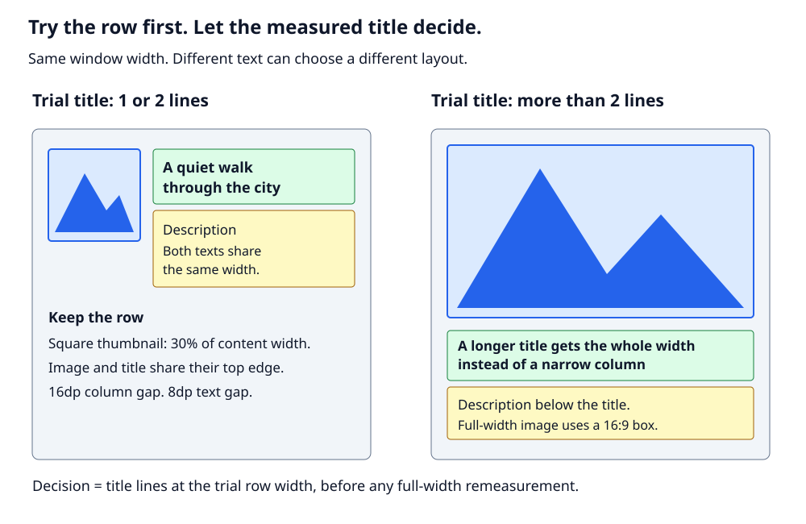

# Build an article preview with a custom ViewGroup

You need one image and two texts.
The image sits beside a title and a description.
Then the design adds a gap that depends on the title's height.

We will build this row step by step.
XML describes the content.
Kotlin controls its size and position.

You need basic Kotlin and Android XML knowledge.
The idea comes from the layouts in [Yumi](https://github.com/Bayram-MKININI/Yumi).

## Start here

Clone this project first.
All code examples use its package and resources.
You do not need to create a new Android project.

Use Android Studio, JDK 17, and Android SDK 36.

```sh
git clone https://github.com/Bayram-MKININI/android-custom-viewgroup-tutorial.git
cd android-custom-viewgroup-tutorial
```

Open the project in Android Studio to set the SDK location.
Or set `ANDROID_HOME` to your SDK.

The finished article preview is already the default screen.
You can run it now:

```sh
./gradlew :app:assembleDebug
./gradlew :app:installDebug
```

The install command needs a device or emulator running API 24 or newer.
Open **Custom ViewGroup Tutorial**.
The first build needs internet access.

## 1. The first design needs no custom layout

You start with a fixed image, a title, and a description:

```text
+---------+    +------------------------+
|         |    | Title                  |
|  Image  |    +------------------------+
|         |    | Description            |
+---------+    +------------------------+
```

A horizontal `LinearLayout` can hold the image and a text column.
A vertical `LinearLayout` can hold the two texts.

```text
Horizontal LinearLayout
    -> ImageView
    -> Vertical LinearLayout
        -> Title TextView
        -> Description TextView
```

That is a normal use of nested layouts.
There is nothing wrong with it.
`ConstraintLayout` could also place all three children in one parent.

## 2. Add exact sizes and positions

Now the design gives more detail:

1. Make the image square.
2. Each side is **30% of the content width**.
3. Leave **16dp** between the image and text column.
4. Align the title's top with the image's top.
5. Give the title and description the same left and right edges.
6. Let the description continue below the image if needed.

**Content width** means the parent width minus its left and right padding.
It does not mean the full screen width.



These rules alone do not require a custom ViewGroup.
`ConstraintLayout` can express this arrangement.
The 30% width is not the hard part.

But there is one more rule.

## 3. The text gap must follow the title height

The space between the title and description must be:

```text
text gap = 25% of measured title height
```

Why use this rule?
In this teaching design, a taller title gets more space below it.
It is a design choice, not a general UI rule.

Suppose the title height is 40 pixels.
The gap is 10 pixels.
If a longer title becomes 80 pixels tall, the gap becomes 20 pixels.

A fixed XML margin does not follow that change.
Adding another layout does not calculate it either.
There is no general ConstraintLayout margin expression for
`title.measuredHeight * 0.25`.

We need a small calculation after measuring the title.
We could add code around a standard layout.
Here, we will put all the size and position rules in one custom parent.

## 4. Give the parent three children

A `ViewGroup` is a View that contains other Views.
It is the **parent**.
The Views inside it are its **children**.

Our structure is:

```text
ArticlePreviewView
    -> ImageView
    -> Title TextView
    -> Description TextView
```

We keep native text and image drawing.
We only replace the layout rules.

There are two jobs:

- `onMeasure()` finds the sizes.
- `onLayout()` assigns the positions.

Let's do them in that order.

## 5. Find the sizes in onMeasure

Android gives the parent a width limit.
In this sample, the parent must use that exact width.

First, remove the padding.
Then calculate the image and text widths:

```kotlin
val contentWidth = MeasureSpec.getSize(widthMeasureSpec) - paddingLeft - paddingRight
val imageSide = (contentWidth * 0.3).toInt()
val textWidth = contentWidth - imageSide - columnGap
```

`columnGap` comes from the `16dp` resource.
Android converts it to pixels.
All measurement code works in pixels.

For example:

```text
content width       400px
image side          120px  (30% of 400)
column gap           16px  (if density makes 16dp equal 16px)
text width          264px
```

Measure the image as a square.
Measure both texts at the calculated text width.
Let the texts grow in height:

```kotlin
val imageSpec = MeasureSpec.makeMeasureSpec(imageSide, MeasureSpec.EXACTLY)
image.measure(imageSpec, imageSpec)

val textWidthSpec = MeasureSpec.makeMeasureSpec(textWidth, MeasureSpec.EXACTLY)
val textHeightSpec = MeasureSpec.makeMeasureSpec(0, MeasureSpec.UNSPECIFIED)
title.measure(textWidthSpec, textHeightSpec)
textGap = (title.measuredHeight * 0.25).toInt()
description.measure(textWidthSpec, textHeightSpec)
```

A `MeasureSpec` is a size with a rule:

| Mode | Meaning |
| --- | --- |
| `EXACTLY` | Use this size |
| `AT_MOST` | Use up to this size |
| `UNSPECIFIED` | No limit for this width or height |

Notice the order.
The title is measured before we calculate its gap.
We do not guess how many lines it will use.

The parent must contain the taller column:

```kotlin
val textColumnHeight = title.measuredHeight + textGap + description.measuredHeight
val desiredHeight =
    paddingTop + maxOf(imageSide, textColumnHeight) + paddingBottom
```

The full class reports its size with `setMeasuredDimension()`.
It uses `resolveSizeAndState()` to follow Android's measurement rules.

Measuring does not place a child.
It only gives us `measuredWidth` and `measuredHeight`.

## 6. Assign positions in onLayout

For left-to-right reading, use these rules:

```text
image.left      = left padding
image.top       = top padding

title.left      = image.right + column gap
title.top       = image.top

description.left = title.left
description.top  = title.bottom + text gap
```

Call `layout()` to assign each rectangle:

```kotlin
title.layout(
    textLeft,
    paddingTop,
    textLeft + title.measuredWidth,
    paddingTop + title.measuredHeight
)
```

The four arguments are **left, top, right, bottom**.
They are not x, y, width, height.
All positions are local to the parent.

The finished class also handles right-to-left layouts.
It puts the image on the right and the text column on the left.

### What about onDraw?

We do not need it.
`onDraw()` paints a View's own custom content.
It does not size or place children.

`TextView` already draws text.
`ImageView` already draws its image.
Android draws the children through `dispatchDraw()`.


Use `requestLayout()` when your own size or position rules change.
Use `invalidate()` when only your custom drawing changes.
These request work later.
Android does not have to run all three methods on every frame.

## 7. The complete example

The sample uses a `ScrollView`.
It gives the row room to grow vertically.
The row must receive an exact width and no height limit.

All three children must stay visible.
Child margins are not supported.
The parent handles the gaps itself.

### XML

This is `app/src/main/res/layout/article_preview_example.xml`:

```xml
<?xml version="1.0" encoding="utf-8"?>
<ScrollView xmlns:android="http://schemas.android.com/apk/res/android"
    android:id="@+id/scroll"
    android:layout_width="match_parent"
    android:layout_height="match_parent">

    <dev.bayram.viewgrouptutorial.ArticlePreviewView
        android:id="@+id/article_preview"
        android:layout_width="match_parent"
        android:layout_height="wrap_content"
        android:padding="@dimen/content_padding">

        <ImageView
            android:id="@+id/article_image"
            android:layout_width="wrap_content"
            android:layout_height="wrap_content"
            android:importantForAccessibility="no"
            android:scaleType="centerCrop"
            android:src="@drawable/example_landscape" />

        <TextView
            android:id="@+id/article_title"
            android:layout_width="wrap_content"
            android:layout_height="wrap_content"
            android:text="@string/article_title"
            android:textColor="?android:attr/textColorPrimary"
            android:textSize="22sp"
            android:textStyle="bold" />

        <TextView
            android:id="@+id/article_description"
            android:layout_width="wrap_content"
            android:layout_height="wrap_content"
            android:text="@string/article_description"
            android:textColor="?android:attr/textColorSecondary"
            android:textSize="16sp" />
    </dev.bayram.viewgrouptutorial.ArticlePreviewView>
</ScrollView>
```

The parent supplies exact child widths in code.
For this component, those calculations replace the XML `wrap_content` sizes.
`centerCrop` fills the image box and crops any extra picture area.
It does not set the box size.

This image is decoration.
It is hidden from screen readers.
If an image gives useful information, use a translated `contentDescription`.

The project includes the [text and spacing resources](app/src/main/res/values/strings.xml)
and the [image](app/src/main/res/drawable/example_landscape.xml).

### Kotlin

This is the full class in
`app/src/main/java/dev/bayram/viewgrouptutorial/ArticlePreviewView.kt`.

Android creates the parent before its XML children are ready.
We find them in `onFinishInflate()`, after they exist.

```kotlin
package dev.bayram.viewgrouptutorial

import android.content.Context
import android.util.AttributeSet
import android.view.ViewGroup
import android.widget.ImageView
import android.widget.TextView

/**
 * Keeps the image and title top-aligned, with a text gap based on title height.
 * Requires exact width, unbounded height, and three visible XML children without margins.
 */
class ArticlePreviewView @JvmOverloads constructor(
    context: Context,
    attrs: AttributeSet? = null,
    defStyleAttr: Int = 0
) : ViewGroup(context, attrs, defStyleAttr) {

    private lateinit var image: ImageView
    private lateinit var title: TextView
    private lateinit var description: TextView
    private val columnGap = resources.getDimensionPixelSize(R.dimen.article_column_gap)
    private var textGap = 0

    override fun onFinishInflate() {
        super.onFinishInflate()
        require(childCount == 3) { "ArticlePreviewView requires exactly three children" }
        image = requireNotNull(findViewById<ImageView>(R.id.article_image))
        title = requireNotNull(findViewById<TextView>(R.id.article_title))
        description = requireNotNull(findViewById<TextView>(R.id.article_description))
        require(image.parent === this && title.parent === this && description.parent === this) {
            "Image, title, and description must be direct children"
        }
    }

    override fun onMeasure(widthMeasureSpec: Int, heightMeasureSpec: Int) {
        require(MeasureSpec.getMode(widthMeasureSpec) == MeasureSpec.EXACTLY) {
            "ArticlePreviewView requires exact width"
        }
        require(MeasureSpec.getMode(heightMeasureSpec) == MeasureSpec.UNSPECIFIED) {
            "ArticlePreviewView requires unbounded height; use the sample ScrollView"
        }
        require(image.visibility == VISIBLE && title.visibility == VISIBLE && description.visibility == VISIBLE) {
            "This example requires all three children to be visible"
        }
        val contentWidth = MeasureSpec.getSize(widthMeasureSpec) - paddingLeft - paddingRight
        val imageSide = (contentWidth * 0.3).toInt()
        val textWidth = contentWidth - imageSide - columnGap
        require(textWidth > 0) { "Not enough width for padding, image, and column gap" }

        val imageSpec = MeasureSpec.makeMeasureSpec(imageSide, MeasureSpec.EXACTLY)
        image.measure(imageSpec, imageSpec)

        val textWidthSpec = MeasureSpec.makeMeasureSpec(textWidth, MeasureSpec.EXACTLY)
        val textHeightSpec = MeasureSpec.makeMeasureSpec(0, MeasureSpec.UNSPECIFIED)
        title.measure(textWidthSpec, textHeightSpec)
        textGap = (title.measuredHeight * 0.25).toInt()
        description.measure(textWidthSpec, textHeightSpec)

        val textColumnHeight = title.measuredHeight + textGap + description.measuredHeight
        val childState = combineMeasuredStates(
            image.measuredState,
            combineMeasuredStates(title.measuredState, description.measuredState)
        )
        setMeasuredDimension(
            resolveSizeAndState(
                MeasureSpec.getSize(widthMeasureSpec),
                widthMeasureSpec,
                childState
            ),
            resolveSizeAndState(
                maxOf(
                    suggestedMinimumHeight,
                    paddingTop + maxOf(imageSide, textColumnHeight) + paddingBottom
                ),
                heightMeasureSpec,
                childState shl MEASURED_HEIGHT_STATE_SHIFT
            )
        )
    }

    override fun onLayout(changed: Boolean, left: Int, top: Int, right: Int, bottom: Int) {
        val rtl = layoutDirection == LAYOUT_DIRECTION_RTL
        val imageLeft = if (rtl) right - left - paddingRight - image.measuredWidth else paddingLeft
        val textLeft = if (rtl) paddingLeft else imageLeft + image.measuredWidth + columnGap

        image.layout(
            imageLeft,
            paddingTop,
            imageLeft + image.measuredWidth,
            paddingTop + image.measuredHeight
        )
        title.layout(
            textLeft,
            paddingTop,
            textLeft + title.measuredWidth,
            paddingTop + title.measuredHeight
        )
        val descriptionTop = title.bottom + textGap
        description.layout(
            textLeft,
            descriptionTop,
            textLeft + description.measuredWidth,
            descriptionTop + description.measuredHeight
        )
    }
}
```

`require()` reports uses this example does not support.
`combineMeasuredStates()` passes on child size warnings.
`resolveSizeAndState()` reports sizes under the parent's rules.
The height warning flags need `MEASURED_HEIGHT_STATE_SHIFT`.

These are Android details around our main rule:
**measure the title, calculate its gap, then place the description**.

## 8. Change the text and watch the result

Open [the string resources](app/src/main/res/values/strings.xml).
Replace the title with a longer sentence.
Run the app again.

The title should use more lines when needed.
Its gap should grow with its measured height.
The description should move down.
The image must stay square and keep its top aligned with the title.
The parent must grow enough to contain both columns.

Also try large fonts, a narrow window, and right-to-left layout.
Check the screen with a screen reader.

Run the tests and Android lint:

```sh
./gradlew :app:testDebugUnitTest :app:lintDebug
```

The [tests](app/src/test/java/dev/bayram/viewgrouptutorial/ArticlePreviewViewTest.kt)
check image size, both gaps, text edges, parent height, and reading direction.
They also check the result after the title becomes longer.

## A short note about performance

Nested layouts can add measurement and placement work.
A size change may affect parents and other children.
But Android does not always measure the whole tree again.

Our custom parent keeps all three children in one layer.
That does not prove it is faster.
This project has no performance comparison.
Measure the same screen both ways before claiming a speedup.

Use standard layouts when they fit.
Use a custom parent when the rules are clearer as code.

## References

- [Article preview source](app/src/main/java/dev/bayram/viewgrouptutorial/ArticlePreviewView.kt)
- [Article preview XML](app/src/main/res/layout/article_preview_example.xml)
- [Custom Android components](https://developer.android.com/develop/ui/views/layout/custom-views/custom-components)
- [MeasureSpec](https://developer.android.com/reference/android/view/View.MeasureSpec)
- [Macrobenchmark](https://developer.android.com/topic/performance/benchmarking/macrobenchmark-overview)
